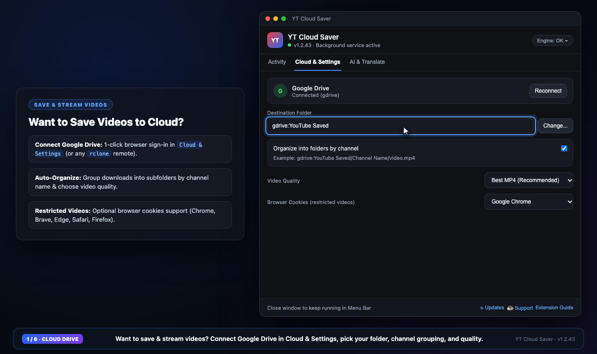
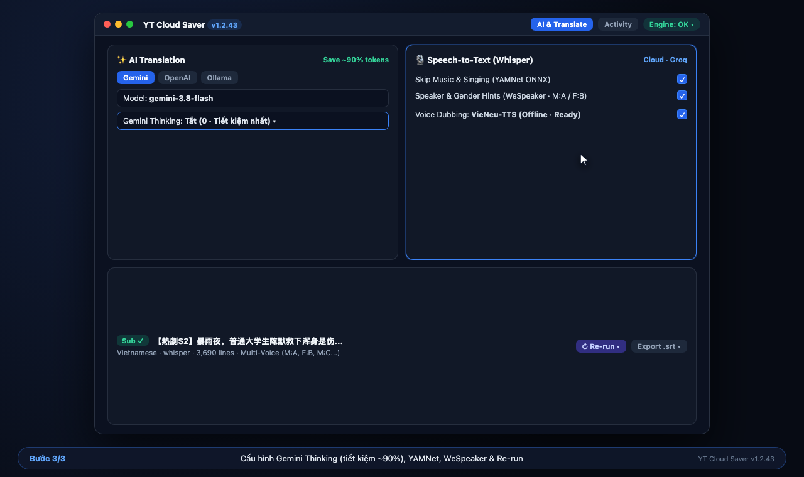
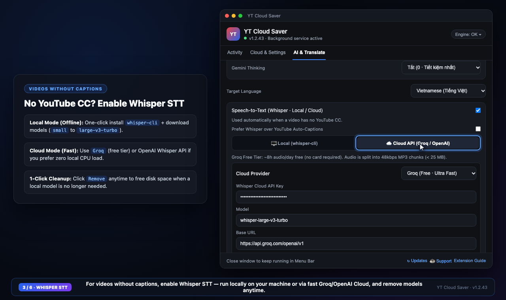
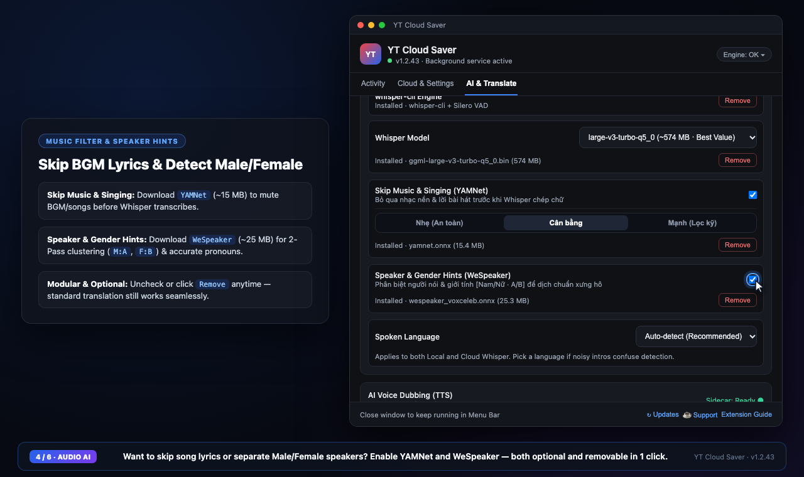
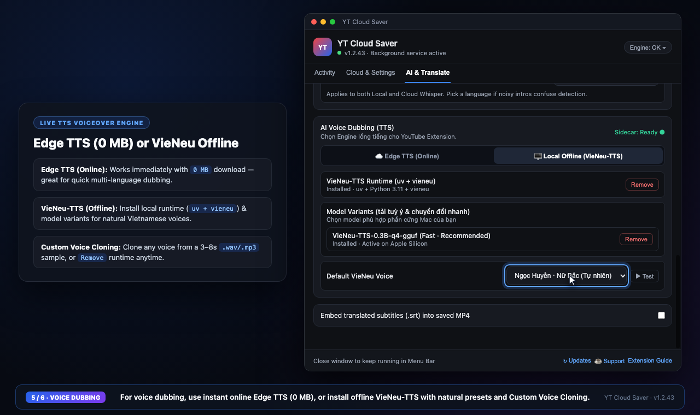
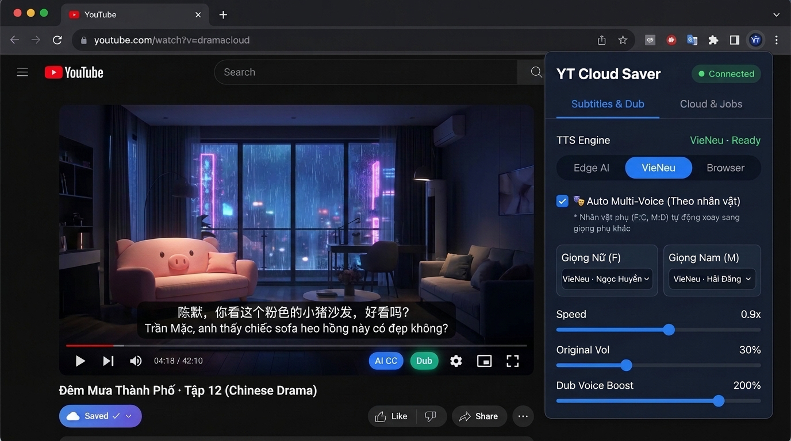
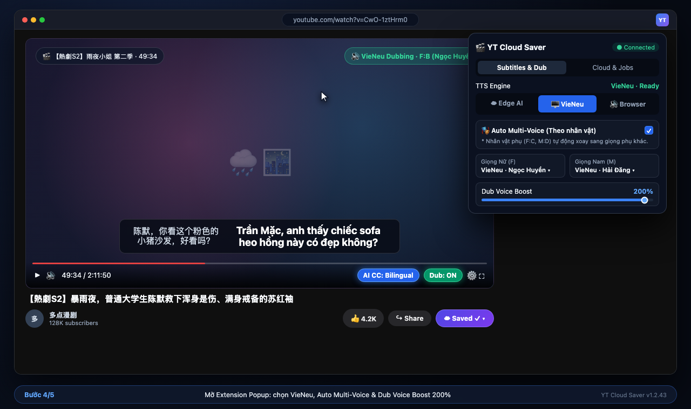
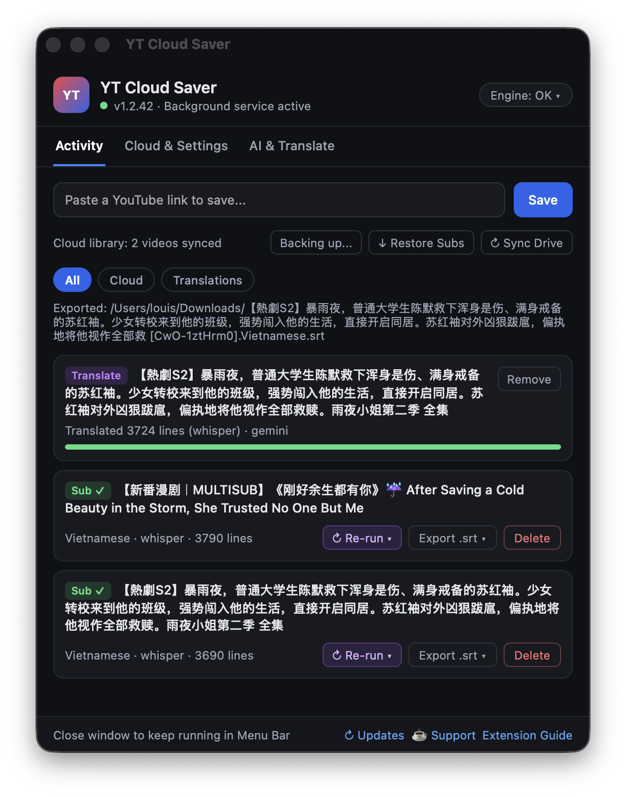

<p align="center">
  
</p>

<h1 align="center">YT Cloud Saver</h1>

<p align="center">
  Save YouTube videos straight to <b>Google Drive</b> (or any <code>rclone</code> cloud) in 1 click — with modular <b>Real-Time AI Subtitles</b>, <b>Local/Cloud Whisper STT</b>, <b>YAMNet Music Filtering</b>, <b>WeSpeaker Male/Female Diarization</b>, and <b>Auto Multi-Voice Dubbing (Edge TTS &amp; Offline VieNeu-TTS)</b>.
</p>

<p align="center">
  
  
  
  
  
  
</p>

---

## Interactive Feature Walkthrough

<p align="center">
  
</p>

<!-- <p align="center">
  <a href="docs/demo.mp4"><b>▶ Watch Full Walkthrough Video with VieNeu-TTS Voiceover &amp; English Subtitles (<code>docs/demo.mp4</code>)</b></a>
</p> -->
https://github.com/user-attachments/assets/a8bbd803-0ee0-4c0b-bca1-d6021ea9a04c

---

## Modular Feature Guide — Enable Only What You Need

Every AI and audio add-on in **YT Cloud Saver** is **modular**: install only the components you want, uncheck or click **`Remove`** anytime to free disk space, and core features continue working seamlessly.

### 1. Want to Save &amp; Stream Videos to Cloud? → Connect Google Drive
- Open **`Cloud & Settings`** and click **`Connect`** for 1-click Google Drive sign-in (or enter any `rclone` remote path).
- Customize your **Destination Folder**, toggle **Organize into folders by channel**, pick **Video Quality** (`Best MP4 / 1080p / 720p`), and optionally enable **Browser Cookies** for restricted videos.
- On YouTube, click **`Save to Cloud`** — once archived, click **`Saved ✓ ▾ → Play from Cloud`** to stream directly inside YouTube with zero local disk cache.

<p align="center">
  
</p>

### 2. Want Real-Time Translated Subtitles? → Connect an AI Provider
- Open **`AI & Translate`** and pick any provider:
  - **Gemini** (`gemini-3.8-flash` / `flash-lite`) — set **Gemini Thinking** to **`Off (0)`** to cut output token costs by ~90%.
  - **OpenAI / Custom** — works with OpenAI, OpenRouter, DeepSeek, Groq, Together, or any OpenAI-compatible endpoint.
  - **Ollama (Local)** — 100% free offline translation using local models on your machine.

<p align="center">
  
</p>

### 3. Video Has No Captions? → Enable Speech-to-Text (`Whisper · Local or Cloud`)
- Toggle **`Speech-to-Text (Whisper · Local / Cloud)`** so videos without YouTube CC are transcribed automatically (with built-in repetition/hallucination cleanup):
  - **`🖥 Local (whisper-cli)`:** 1-click install of `whisper.cpp` + Silero VAD and model choices from `tiny` (~75 MB) up to `large-v3-turbo`. Click **`Remove`** anytime if you don't need local models.
  - **`☁️ Cloud API (Groq / OpenAI)`:** Offload transcription to Groq's fast cloud Whisper (`whisper-large-v3-turbo`) or OpenAI with zero local CPU/RAM load.

<p align="center">
  
</p>

### 4. Want to Skip Song Lyrics &amp; Separate Male/Female Voices? → `YAMNet` &amp; `WeSpeaker`
- **`Skip Music & Singing (YAMNet)`:** Downloads `yamnet.onnx` (~15.4 MB) to mute background music and singing segments (`Low / Balanced / High`) before Whisper transcribes, preventing unwanted song lyrics in subtitles.
- **`Speaker & Gender Hints (WeSpeaker)`:** Downloads `wespeaker_voxceleb.onnx` (~25.3 MB) + F0 pitch analysis for **2-Pass Agglomerative Speaker Clustering** (`M:A`, `F:B`, `F:C`...), giving the LLM gender-accurate pronoun hints and powering Multi-Voice dubbing.
- Both add-ons are completely optional — uncheck them or click **`Remove`** anytime without affecting normal translation.

<p align="center">
  
</p>

### 5. Want Live Voiceover Dubbing? → `Edge TTS` (Online) or `VieNeu-TTS` (Offline)
- **`☁️ Edge TTS (Online)`:** Ready out of the box (`0 MB` download), multi-language neural voices with automatic macOS system voice fallback.
- **`🖥 Local Offline (VieNeu-TTS)`:** Click **`Install`** to set up the local runtime (`uv + vieneu`) and download quantized model variants optimized for Apple Silicon / CPU — featuring natural Northern/Central/Southern Vietnamese voices plus **Custom Voice Cloning** from a 3–8s `.wav/.mp3` sample (with 1-click **`Remove`** anytime).

<p align="center">
  
</p>

### 6. Watch on YouTube, Enable Auto Multi-Voice &amp; Manage Subtitles
- Right inside YouTube's player bar, toggle **`AI CC`** (`OFF → Bilingual → Translated`) and **`Dub`** (`ON / OFF`).
- Open the **Extension Popup** (`Subtitles & Dub` tab) to switch between **`Edge AI` / `VieNeu` / `Browser`**, enable **`🎭 Auto Multi-Voice`** (automatically assigns Female `F` & Male `M` lead voices and rotates secondary speakers `F:C`, `M:D`...), adjust **Speed** & **Original Vol**, boost voice clarity up to **`200%`**, and customize subtitle font size, colors, and opacity.
- In the Desktop **`Activity`** tab, track cloud/translation jobs, click **`↻ Re-run ▾`** (`Re-translate Only` or `Re-whisper + Translate`), **`Export .srt ▾`** (`Translated / Original / Bilingual`), or backup/restore subtitles to Google Drive.

<p align="center">
  
</p>

<p align="center">
  
</p>

<p align="center">
  
</p>

---

## AI Audio &amp; Translation Pipeline

```text
YouTube Audio ─► [Optional] YAMNet ONNX (Mute Music & Singing)
                      │
                      ▼
             Whisper STT (Local whisper.cpp + VAD  OR  Cloud Groq / OpenAI)
                      │
                      ▼
             [Optional] WeSpeaker ONNX + F0 (2-Pass AHC Speaker & Gender Tags: M:A, F:B...)
                      │
                      ▼
             LLM Translation (Gemini Thinking=0 / OpenAI / Ollama)
                      │
                      ▼
             Live Dubbing (Edge TTS Online  OR  VieNeu-TTS Offline + Auto Multi-Voice + 200% Boost)
```

### Keyboard Shortcuts (YouTube &amp; Cloud Player)

| Shortcut | Action |
| :--- | :--- |
| `Option / Alt + C` | Toggle &amp; cycle **`AI CC`** (`OFF → Bilingual → Translated`) |
| `Option / Alt + D` | Toggle **`Dub`** (`ON / OFF`) |
| `Space / K`, `← / →`, `J / L`, `M`, `F` | Full YouTube-style playback shortcuts inside Cloud Player |

---

## Installation

### Step 1: Install Desktop App &amp; Connect Google Drive
1. Download the installer for your OS from the [**Latest Release**](../../releases/latest):
   - **macOS:** `.dmg` (drag `YT Cloud Saver.app` into **Applications**)
     > **macOS Note:** Because the app is not notarized with an Apple Developer ID, macOS may show *"YT Cloud Saver is damaged and can't be opened"*. Run this once in Terminal to clear the quarantine flag:
     > ```bash
     > xattr -cr "/Applications/YT Cloud Saver.app"
     > ```
   - **Windows:** `.exe` / `.msi` *(Click **More info → Run anyway** if SmartScreen prompts).*
   - **Linux:** `.AppImage` / `.deb`
2. Open **YT Cloud Saver** — if `yt-dlp`, `ffmpeg`, or `rclone` are missing, click **Download Missing Tools** right inside the app.
3. Configure only the features you want in **Cloud &amp; Settings** and **AI &amp; Translate**.

### Step 2: Install the Chrome Extension
1. Click **Extension Guide** at the bottom-right of the Desktop App, then click **1. Open Extension Folder** and **2. Open `chrome://extensions`** *(or download `yt-cloud-saver-extension.zip` from the [**Latest Release**](../../releases/latest))*.
2. Enable **Developer mode** (top right) in Chrome and drag &amp; drop the `extension` folder onto the page.

---

## Development

```bash
# Desktop App (Tauri v2)
cd desktop/src-tauri && cargo run

# Package Chrome Extension ZIP
./scripts/package.sh

# Optional Standalone Node.js Companion Server
node server/index.js
```

---

## Support

YT Cloud Saver is free and open source. If it saves you time or makes watching videos more enjoyable, you can buy me a coffee:

<a href="https://ko-fi.com/luantruong19136"></a>

**From Vietnam:** scan with MoMo or any banking app (VietQR / Napas 247).


---

## Disclaimer

This project is intended for personal archiving of content you have permission to save. It is not affiliated with, endorsed by, or sponsored by YouTube, Google LLC, or Alphabet Inc.
