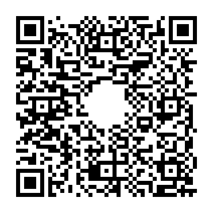

<p align="center">
  
</p>

<h1 align="center">YT Cloud Saver</h1>

<p align="center">
  Save YouTube videos straight to <b>Google Drive</b> (or any <code>rclone</code> cloud) in 1 click, with <b>AI Bilingual Subtitles</b>, <b>Edge Neural TTS Dubbing</b>, <b>Whisper.cpp</b> offline transcription, and instant inline Cloud playback.
</p>

<p align="center">
  
  
  
  
  
</p>

---

## Demo

https://github.com/user-attachments/assets/fd3dc00d-2bef-45b1-a8cb-98be6c803195

https://github.com/user-attachments/assets/03aaa79a-9368-4505-a0cc-7292cde233a3

<p align="center">
  
</p>

<p align="center">
  
</p>

---

## Features

| Feature | Description |
| :--- | :--- |
| **1-Click Save & Cloud Menu** | Adds a single **`Save to Cloud`** / **`Saved ✓ ▾`** pill next to Like & Share with **Play from Cloud** (inline), **Re-save / Update**, and **Remove from Cloud** (2-step confirm). |
| **Native Player Bar (`AI CC` + `Dub`)** | Integrates **`AI CC`** (cycles `OFF → Bilingual → Translated`) and **`Dub`** directly into YouTube's bottom-right control bar (`.ytp-right-controls`), auto-hiding with the player controls. |
| **AI Subtitles + Whisper.cpp** | Translates YouTube transcripts via **Gemini** or **OpenAI** with chunked `whisper.cpp` fallback for videos without captions, progressive loading, and `Export .srt ▾` (**Translated / Original / Bilingual**). |
| **Edge Neural TTS Dubbing** | Built-in Rust WebSocket Edge TTS (`Hoài Mỹ`, `Nam Minh`, `Aria`, `Guy`) with batch pre-buffering, adaptive speech speed synced to video `playbackRate`, and automatic disk cache cleanup (100 MB / 3 days). |
| **Subtitle Customizer (Popup)** | Two-tab Extension Popup (`Subtitles & Dub` + `Cloud & Jobs`) with live preview, 2-way **Display Mode** sync, size (`12–32px`), text/background colors, opacity (`0–100%`), voice, speed, and dub volume. |
| **Fast Inline Cloud Player** | Streams saved MP4s from Google Drive right inside the YouTube player frame via `rclone serve http` range proxy (zero disk cache, 15-min idle auto-stop) with a YouTube-style control bar and `✕ YouTube` switch-back. |
| **Subtitle Backup & Restore** | Automatically backs up cached subtitles to `<Remote>/_ytcs_subtitles/` after translation, with **`↑ Backup Subs`** and **`↓ Restore Subs`** buttons when Drive is connected. |
| **Auto-Organize & Sync** | Organizes downloads into `<Destination>/<Channel Name>/`, supports browser cookies for restricted videos, and syncs `Saved ✓` status across devices via `↻ Sync Drive`. |

### Keyboard Shortcuts (YouTube & Cloud Player)

| Shortcut | Action |
| :--- | :--- |
| `Option / Alt + C` | Toggle & cycle **`AI CC`** (`OFF → Bilingual → Translated`) |
| `Option / Alt + D` | Toggle **`Dub`** (`ON / OFF`) |
| `Space / K`, `← / →`, `J / L`, `M`, `F` | Full YouTube-style playback shortcuts inside Cloud Player |

---

## Installation (For Everyone)

### Step 1: Install Desktop App & Connect Google Drive
1. Download the installer for your OS from the [**Latest Release**](../../releases/latest):
   - **macOS:** `.dmg` (drag `YT Cloud Saver.app` into **Applications**)
     > **macOS Note:** Because the app is not notarized with an Apple Developer ID, macOS may show *"YT Cloud Saver is damaged and can't be opened"*. Run this once in Terminal to clear the quarantine flag:
     > ```bash
     > xattr -cr "/Applications/YT Cloud Saver.app"
     > ```
   - **Windows:** `.exe` / `.msi`
     > **Windows Note:** Because the app is not signed with a paid EV certificate, Windows SmartScreen may show *"Windows protected your PC"*. Click **More info → Run anyway** to install.
   - **Linux:** `.AppImage` / `.deb`
2. Open **YT Cloud Saver** — if `yt-dlp`, `ffmpeg`, or `rclone` are missing, click **Download Missing Tools** right inside the app (no terminal needed).
3. Go to **Cloud & Settings** and click **Connect** to sign in to Google Drive in your browser.

### Step 2: Install the Chrome Extension
1. Click **Extension Guide** at the bottom-right of the Desktop App, then click **1. Open Extension Folder** and **2. Open `chrome://extensions`** *(or download `yt-cloud-saver-extension.zip` from the [**Latest Release**](../../releases/latest))*.
2. Enable **Developer mode** (top right) in Chrome.
3. Drag & drop the highlighted `extension` folder onto the Chrome Extensions page (or click **Load unpacked**).

### Step 3: Save & Watch
- Open any YouTube video and click **Save to Cloud**.
- Track progress in the Desktop App or Extension Popup.

---

## Development

### Desktop App (Tauri v2)
```bash
cd desktop/src-tauri
cargo run
```

### Package Extension ZIP
```bash
./scripts/package.sh
```

### Standalone Node.js Server (Optional CLI Mode)
If you prefer running the companion server without the Tauri UI:
```bash
node server/index.js
```

---

## Support

YT Cloud Saver is free and open source. If it saves you time or makes watching videos more enjoyable, you can buy me a coffee:

<a href="https://ko-fi.com/luantruong19136"></a>

**From Vietnam:** scan with MoMo or any banking app (VietQR / Napas 247).



---

## Disclaimer

This project is intended for personal archiving of content you have permission to save. It is not affiliated with, endorsed by, or sponsored by YouTube, Google LLC, or Alphabet Inc.
